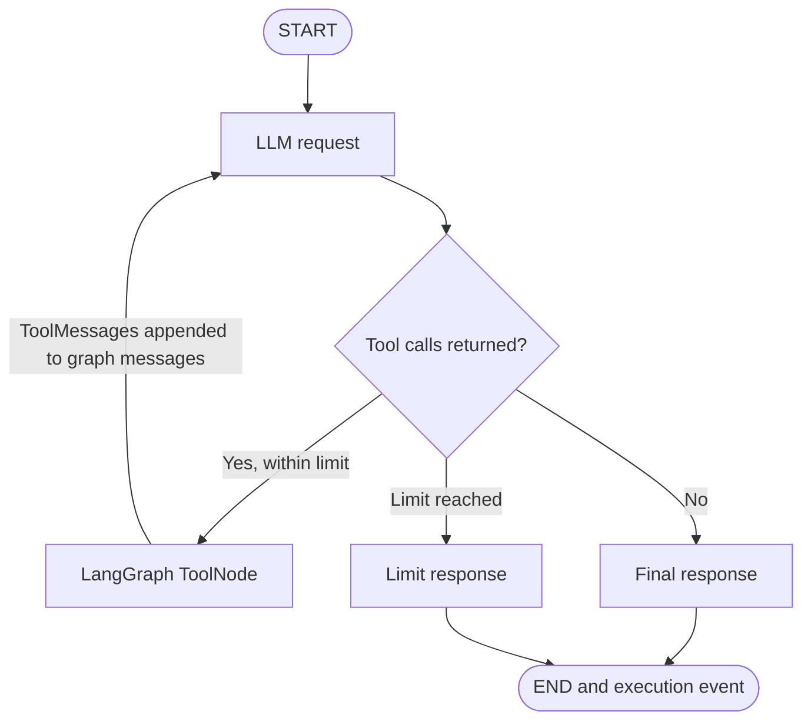

# Phase 1: AI Agent Foundation and Execution Environment

## Objective

Phase 1 provides a real provider-backed tool agent, a deterministic offline demonstration, validated execution state, and structured events. It establishes an observable execution boundary for later telemetry collection. It does not include persistence, a web service, model training, or recovery automation.

An AI agent accepts a task, selects an action, observes its result, and can continue before producing a final response. AgentGuard's configured mode uses a chat model for those decisions. Its `--demo` mode is an explicitly rule-based planner for offline examples and tests; it does not claim LLM reasoning.

## Provider workflow



`agentguard.agent.graph.run_llm` creates one `ExecutionState` and `EventCollector` per run. The graph state carries that execution ID, task ID, current step, and a message history. The LLM node invokes the configured chat model with registered tool schemas. Conditional routing sends tool requests to LangGraph's `ToolNode`; `ToolMessage` outputs are appended to the same conversation and routed back to the model. When the model returns a message without tool calls, its content becomes the final response. A maximum of eight tool calls is allowed by default, with an invocation parameter for tests and callers.

Tool wrappers call the same calculator, local sample search, and company retrieval functions as demo mode. They record tool lifecycle events and catch failures into structured tool results so the model can observe them. Invalid tool schemas are handled by the ToolNode error callback and recorded as failures. Provider errors fail the execution cleanly.

## Deterministic demo mode

`python -m agentguard --demo <task>` selects a tool using a narrow deterministic planner. The runner executes the selected operations and captures each result. This mode needs no API key and remains clearly identified in the start event as `mode: deterministic`. Search results are from a local sample dataset only. If no sample records match, search returns `matched: false`, an explanatory message, and an empty result list.

## State, status, and events

`ExecutionState` uses unique execution/task UUIDs and records input, step, messages, calls, errors, UTC start/end times, final response, and failure mode. Provider execution retains one state and identifier pair from initialization through its terminal event. Timing starts before model initialization/request work and covers model latency, tools, additional model calls, and final response.

Statuses:

- `pending`: created but not started.
- `running`: execution has started.
- `completed`: all tool calls and final response completed without recorded failure.
- `partially_completed`: at least one tool succeeded and another tool or execution step failed.
- `failed`: no tool succeeded, or the execution failed before usable work completed.

`ExecutionEvent` includes event/execution/task IDs, step number, UTC-aware timestamp, type, component, optional tool name and duration, status, optional error information, and metadata. `EventCollector` rejects inconsistent IDs, duplicate event IDs, naive/out-of-order timestamps, and events emitted before start or after a terminal event. Sensitive credential-like metadata and error text is redacted; raw tool arguments/results are not copied into event metadata. The supported event types are execution start/completion/failure, LLM request, tool selected/start/completion/failure. Events remain in memory and `to_json()` exports them as JSON.

## Failure injection

Failure injection is disabled when `AGENTGUARD_FAILURE_MODE` is unset. Supported values are `invalid_arguments`, `timeout`, `unavailable`, and `exception`. Values are validated in settings and at the direct runner boundary; an unsupported value raises `ConfigurationError`. Timeout injection is deterministic and raises a `TimeoutError`; it does not interrupt a real external request. Failures are recorded and no retries are performed.

## Modules

```text
agentguard/
  agent/       provider runtime and iterative LangGraph workflow
  config/      environment-backed settings and failure-mode validation
  execution/   deterministic planner, tool dispatch, events, status lifecycle
  schemas/     Pydantic state, tool calls, and event contracts
  telemetry/   extension boundary for later telemetry work
  tools/       calculator, local sample search, company sample data
tests/unit/    offline behavior and fake-model graph tests
docs/          phase guide and detailed implementation report
```

Key entry points are `run_agent`, `run_llm`, `run_plan`, `calculate`, `search`, `get_company`, and `EventCollector.to_json`.

## Install and run

Use Python 3.11 or newer:

```bash
python -m pip install -e '.[dev]'
cp .env.example .env
```

Provider execution requires `AGENTGUARD_LLM_PROVIDER` (for example `openai`), `AGENTGUARD_LLM_MODEL`, provider credentials such as `OPENAI_API_KEY`, and the matching LangChain integration. Credentials are not stored in source.

```bash
python -m agentguard --demo "Calculate the total cost of 15 products priced at 250 each" --events-json
python -m agentguard --demo "Find information about Tata Motors and summarize the available company data"
python -m agentguard "Search for agent reliability practices"
python -m pytest -q
```

The CLI displays task, selected tools, tool outcomes, final response, execution status, and total duration.

## Test methodology and actual results

Tests use a fake chat model and the actual LangGraph graph; they need neither credentials nor internet access. They cover repeated LLM/tool turns, tool outputs in later model messages, final response retention, total duration, stable IDs, tool-call limits, tool failures, partial success, configuration validation, event invariants, calculator operations, company lookup failures, and search no-match behavior.

Actual result in this environment: `python3 -m pytest -q` — **25 passed** (Python 3.9.6, installed dependencies already present). Python 3.13.12 is available, but its environment lacks pytest and the project dependencies, and dependencies were not installed for this run. The test run emits a LangGraph pending-deprecation warning and the Python 3.9 interpreter emits a LibreSSL/urllib3 warning.

## Limitations and Phase 2 readiness

Provider execution has not been tested against a live model or real credentials. Tool-call limit defaults to eight; the deterministic planner remains deliberately narrow. Events are in-memory only. Metadata redaction is a defense in depth measure, not a substitute for a future data-retention and privacy policy. Stable IDs, event invariants, and partial-success status now form a more reliable basis for Phase 2 trace storage and feature extraction, but persistence should wait until trace schemas and sensitive-data handling are reviewed.

See [the Phase 1 implementation report](reports/phase-01-implementation-report.md) for the detailed test matrix and terminal evidence.
