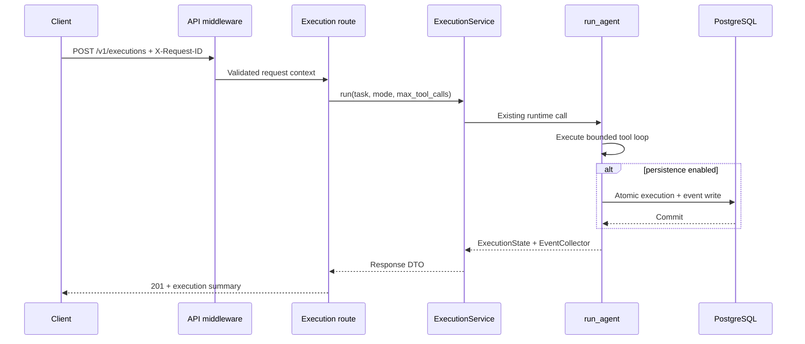

# Phase 4: FastAPI API and Integration Plan

**Status:** Proposed architecture. No API implementation has started.<br>
**Baseline:** Phase 3 is committed at `e3c0971`; Phase 3.3 artifacts and Phase 3.4 diagnostics/recovery contracts are treated as frozen inputs.<br>
**Delivery target:** A deterministic, locally runnable FastAPI service that runs executions, retrieves persisted traces, and exposes deterministic diagnosis plus recovery recommendations without duplicating Phase 3 logic.

## 1. Objective, scope, and non-goals

Phase 4 turns the existing Python entry points and service boundaries into a versioned HTTP API. The API must:

- Run the existing agent without reimplementing execution, diagnostics, ML risk scoring, persistence, or recovery policy.
- Expose stable request/response contracts built from API-specific Pydantic schemas, not internal domain models directly.
- Keep PostgreSQL optional, matching the current runtime: execution works offline, while persistence and trace retrieval require a configured database.
- Reuse `DiagnosticService.analyze(...)` for deterministic diagnosis and recommendations.
- Return a safe failure when optional ML scoring is unavailable; ML risk remains predictive and must never become a confirmed failure or trigger recovery by itself.
- Be testable without PostgreSQL, Docker, an external LLM, or generated model artifacts.

Phase 4 MVP scope:

- Synchronous execution submission and response.
- Execution summary and ordered-event retrieval from PostgreSQL.
- Stateless diagnosis of a supplied event prefix.
- Diagnosis of a persisted execution trace.
- Health/readiness endpoints and consistent API errors.

Explicit non-goals for this phase:

- A frontend, job queue, distributed worker, streaming tokens, or WebSocket events.
- Multi-user authentication, authorization, tenancy, quotas, or billing.
- Automatic recovery execution through the HTTP API.
- New model training, model selection, test-set scoring, or changes to Phase 3 artifacts.
- Duplicating rule diagnosis, ML thresholds, tool policy, or recovery policy in the API layer.

### Recovery execution boundary

The MVP exposes recovery **recommendations**, not automatic recovery execution. The existing `BoundedRecoveryController` requires a caller-supplied one-action `RecoveryExecutor`, but `RecoveryRequest` does not contain a durable, safe context for rebuilding the original tool call: persisted events retain an argument fingerprint, not raw arguments or the original task state. Adding an API executor without that context would either fabricate actions or require unsafe client-supplied execution instructions.

Guarded recovery execution is therefore a separate follow-on in Section 10. It requires a reviewed recovery-context contract, human-approval handling, and durable attempt budgeting before any route can trigger it.

## 2. Existing baseline and integration points

The API will wrap, not replace, these interfaces:

| Existing component | Phase 4 use |
|---|---|
| `agentguard.agent.runtime.run_agent(...)` | Sole execution entry point for deterministic and LLM modes; returns `ExecutionState` and `EventCollector` and persists when configured. |
| `agentguard.execution.runner.run_plan(...)` | Remains an internal deterministic/testing path; not a second public execution implementation. |
| `agentguard.schemas.state.ExecutionState` | Source for execution response mapping. |
| `agentguard.schemas.events.EventCollector` / `ExecutionEvent` | Source for event responses and diagnosis input. |
| `agentguard.database.repositories.retrieve_execution_trace(...)` | Read path for execution summary and ordered events. |
| `agentguard.diagnostics.service.DiagnosticService` | Sole diagnosis/recommendation implementation. |
| `agentguard.diagnostics.types.DiagnosisReport` | Internal result mapped to API response schemas. |
| `agentguard.ml.risk.ModelRiskScorer` | Optional server-side scorer; absent by default because Phase 3.3 does not persist model binaries. |
| `agentguard.telemetry.persistence.persist_if_configured(...)` | Current write path inside `run_agent`; must not be duplicated by the API. |
| `agentguard.config.database.DatabaseSettings.from_env()` | Database enablement and optional task-text retention. |

Important gaps to preserve explicitly:

- `run_agent` is synchronous and may block on provider or tool work. Phase 4 does not add a queue.
- A persisted trace stores the execution summary and events, but not `final_output`, `messages`, raw tool arguments, or raw tool results. `GET /v1/executions/{id}` must not fabricate fields the database cannot supply.
- `run_agent` persists inside the call. The API must not persist the same execution a second time.
- FastAPI, Uvicorn, and an HTTP test client are not currently declared dependencies.
- PostgreSQL migration/runtime behavior remains unverified in this environment and is not required for unit/API tests.

## 3. API conventions and endpoint specification

### Common conventions

- Base path: `/v1`; health endpoints remain outside the versioned business API.
- Content type: `application/json`; errors use `application/problem+json`.
- Identifiers: UUID strings; timestamps: UTC ISO 8601 with `Z`/offset.
- Success responses use explicit Pydantic response models.
- Error envelopes follow RFC 9457-style fields: `type`, `title`, `status`, `detail`, `instance`, `code`, `request_id`.
- Request IDs are accepted from `X-Request-ID` only after validation; otherwise the server generates one. The ID is returned in the response and logs.
- Pagination uses opaque/ordered cursors based on stored `event_index`; no offset-based pagination.
- No client-supplied ML signal, recovery executor, tool policy, or arbitrary internal failure mode is accepted.

### Endpoint summary

| Method | Path | Purpose | Persistence required |
|---|---|---|---|
| `GET` | `/health/live` | Process liveness | No |
| `GET` | `/health/ready` | Configuration/database readiness | No; database checked only when enabled |
| `POST` | `/v1/executions` | Run an agent task synchronously | No; persisted when enabled |
| `GET` | `/v1/executions/{execution_id}` | Read persisted execution summary | Yes |
| `GET` | `/v1/executions/{execution_id}/events` | Read ordered persisted events | Yes |
| `POST` | `/v1/diagnoses` | Diagnose a supplied event prefix statelessly | No |
| `POST` | `/v1/executions/{execution_id}/diagnoses` | Diagnose a persisted execution trace | Yes |

### `GET /health/live`

Returns `200` with `{"status": "ok"}` when the process can serve requests. It performs no database or provider call.

### `GET /health/ready`

Returns `200` when required in-process configuration is valid. When `AGENTGUARD_DATABASE_URL` is set, run a bounded `SELECT 1` through the application session factory and return `503` if it fails. When persistence is disabled, readiness still succeeds because execution is explicitly offline-capable. Never include the database URL or driver exception text in the response.

### `POST /v1/executions`

Request:

```json
{
  "task": "Calculate the total cost of 15 products priced at 250 each",
  "mode": "deterministic",
  "max_tool_calls": 8
}
```

Fields:

- `task`: required, non-blank, bounded to 8,000 characters at the API boundary.
- `mode`: `deterministic` or `llm`; defaults to `deterministic`.
- `max_tool_calls`: integer `1..8`; defaults to the existing `MAX_TOOL_CALLS`.
- `failure_mode` is not part of the public schema. Test-only failure injection may be exposed behind an explicit non-production setting in a later subphase, never by default.

Mapping: `mode=deterministic` calls `run_agent(task, demo=True, max_tool_calls=...)`; `mode=llm` calls `run_agent(task, demo=False, max_tool_calls=...)`. The service must not import or bypass `run_agent`.

Response: `201 Created`.

```json
{
  "execution_id": "uuid",
  "task_id": "uuid",
  "status": "completed",
  "mode": "deterministic",
  "started_at": "2026-11-02T10:00:00Z",
  "completed_at": "2026-11-02T10:00:00.012Z",
  "duration_ms": 12.0,
  "successful_tool_call_count": 1,
  "failed_tool_call_count": 0,
  "tool_calls": [
    {"tool_name": "calculator", "status": "completed", "duration_ms": null}
  ],
  "final_output": "3750",
  "persisted": true
}
```

The response omits raw tool arguments, messages, and internal state. Tool-call errors, if returned, must pass through `redact_text`. An execution that ends as `failed` or `partially_completed` still returns `201` because the API request itself succeeded; clients must inspect `status`. A persistence failure is not a successful response and follows Section 7.

### `GET /v1/executions/{execution_id}`

Returns `200` with the persisted summary:

```json
{
  "execution_id": "uuid",
  "task_id": "uuid",
  "task_description": null,
  "status": "failed",
  "mode": "deterministic",
  "started_at": "2026-11-02T10:00:00Z",
  "completed_at": "2026-11-02T10:00:00.012Z",
  "duration_ms": 12.0,
  "successful_tool_call_count": 0,
  "failed_tool_call_count": 1,
  "metadata": {"failure_mode": null, "current_step": 1}
}
```

`task_description` is `null` unless `AGENTGUARD_STORE_TASK_TEXT=true`. The endpoint returns `404` for an unknown execution and `503` when persistence is disabled. It does not claim to return `final_output`; that field exists only in the immediate execution response.

### `GET /v1/executions/{execution_id}/events`

Query parameters:

- `limit`: `1..500`, default `100`.
- `after_event_index`: optional integer cursor; returns events strictly after that stored index.

Response: `200` with `{"execution_id": "...", "events": [...], "next_after_event_index": 42}`. Event payloads mirror the persisted event fields, including `event_index`, timestamps, status, sanitized error text, and redacted metadata. If no further events exist, `next_after_event_index` is `null`. Unknown execution: `404`.

Implementation note: `retrieve_execution_trace` loads all events. Phase 4 should add a read-only paginated repository function using the existing `(execution_id, timestamp, event_index)` index rather than loading complete traces for every page.

### `POST /v1/diagnoses`

Stateless diagnosis for an observed prefix, useful when persistence is disabled or a caller already has events.

Request:

```json
{
  "events": [
    {
      "event_id": "evt-1",
      "execution_id": "exec-1",
      "task_id": "task-1",
      "step_number": 0,
      "timestamp": "2026-11-02T10:00:00Z",
      "event_type": "execution_started",
      "component": "agent",
      "status": "running",
      "metadata": {}
    }
  ]
}
```

Rules:

- Maximum 1,000 events per request.
- Use `ExecutionEvent` validation; no alternate event parser.
- Pass the sequence directly to `DiagnosticService.analyze`.
- Clients cannot provide `ml_signal`; only the server-configured scorer may run.
- Empty events are valid and yield the existing unknown/pre-start diagnosis.
- Non-empty prefixes must begin with exactly one `execution_started` and must not contain events after a terminal event.
- Return `200` with the mapped `DiagnosisReport`, including `diagnosis`, `recommendations`, and `ml_error` when optional scoring failed.

The response includes recommendations because they are deterministic policy output, not executed actions. Each recommendation exposes its action, target, risk, approval requirement, maximum attempts, evidence IDs, rationale, and expected benefit.

### `POST /v1/executions/{execution_id}/diagnoses`

Loads the persisted ordered events for an execution and calls the same diagnosis service. Returns `404` for an unknown execution and `503` when persistence is disabled. The request has no body. The same `DiagnosisReport` schema is returned.

This route is read-only with respect to the original execution: it must not mutate execution state, append events, launch recovery, or persist a synthetic session.

### Deferred endpoints

- `POST /v1/recovery-sessions` and `GET /v1/recovery-sessions/{session_id}` remain deferred until the guarded execution-context contract is approved.
- `GET /v1/executions` list/search is deferred; it needs explicit retention, filtering, and authorization rules.
- Async execution submission (`202 Accepted` plus poll URL) is deferred until a durable job store exists.

## 4. Request lifecycle and sequences

### Execution lifecycle

1. Middleware validates/propagates `X-Request-ID`, enforces body-size limits, and records start time.
2. The route validates the request schema and delegates to `ExecutionService`; the route contains no agent logic.
3. The service validates mode/task limits and calls the configured runner (`run_agent`) in a worker thread.
4. `run_agent` executes with the existing tool-call budget. If persistence is enabled, its existing adapter writes the execution and events atomically.
5. The service maps `ExecutionState` to an API response and returns `201`.
6. Logs record only request ID, execution ID, mode, status, duration, and persistence outcome.



Persistence semantics:

- If persistence is disabled, execution succeeds with `persisted=false`; retrieval endpoints return `503`.
- If persistence is enabled and the write fails, the current runtime raises `TelemetryPersistenceError`. The API returns `503`; it does not retry the agent, because a retry could duplicate side effects.
- The API must never call `persist_if_configured`/`persist_execution_trace` a second time after `run_agent`.

Concurrency and timeouts:

- Routes and services use synchronous SQLAlchemy and blocking runtime calls; FastAPI runs synchronous route functions in its thread pool. Do not turn these into `async def` wrappers that block the event loop.
- Phase 4 has no safe request-level cancellation for an in-progress synchronous agent run. Bound exposure through `max_tool_calls`, provider client timeouts, process-level timeouts, and deployment concurrency limits. A durable worker is required for reliable cancellation.

### Diagnosis lifecycle

1. Route receives either a supplied event list or an execution ID.
2. For a persisted execution, `TraceService` loads ordered events; no execution is started.
3. The service invokes `DiagnosticService.analyze(events)`; the optional scorer is server-owned and failures are captured as `ml_error`.
4. Recommendations are returned without invoking `BoundedRecoveryController`, a `RecoveryExecutor`, or any tool.
5. The response is `200`; no diagnosis/session record is written in the MVP.

## 5. Service architecture and dependency injection

Suggested structure:

```text
agentguard/
  api/
    __init__.py
    main.py              # create_app(), lifespan, middleware registration
    dependencies.py      # typed dependency providers
    errors.py            # problem-details handlers
    middleware.py        # request ID, body limits, access logging
    schemas.py           # API request/response DTOs only
    routes/
      __init__.py
      health.py
      executions.py
      diagnoses.py
  application/
    __init__.py
    execution_service.py
    diagnosis_service.py
    trace_service.py
    protocols.py
```

Architecture rules:

- `api/` handles HTTP concerns: parsing, status codes, headers, response models, and error envelopes.
- `application/` orchestrates existing components and maps internal models to API response DTOs.
- `agentguard.diagnostics`, `agentguard.agent`, `agentguard.database`, `agentguard.ml`, and `agentguard.telemetry` remain the owners of their logic.
- No route opens a database transaction, builds an LLM, constructs a recovery policy, or calls a tool directly.
- No API schema subclasses a domain model. Explicit mapping prevents accidental exposure of internal fields and gives the public contract its own evolution path.
- `create_app(...)` is an app factory. Settings, session factories, services, and the optional ML scorer are constructed in the lifespan and stored on `app.state`; no database engine is created at import time.
- Dependencies are overridden in tests with fakes; no test requires a live database or provider.
- The optional ML scorer is `None` unless a future artifact-loading configuration exists. Do not load Phase 3.3 artifacts implicitly and do not require scikit-learn for the API.

Application service contracts:

- `ExecutionRunner` protocol: accepts task/mode/max tool calls and returns `(ExecutionState, EventCollector)`. Production adapter calls `run_agent`.
- `TraceReader` protocol: `get_execution(id)`, `list_events(id, limit, after_index)`. Production adapter uses repositories; test adapter returns fixtures.
- `DiagnosisEngine` protocol: wraps `DiagnosticService.analyze`. Production adapter reuses the real service; no alternate diagnosis rules.
- `ExecutionService.run(...)`: maps the runtime result and persistence state to an API DTO.
- `DiagnosisService.diagnose_events(...)` and `.diagnose_execution(...)`: share one mapping function and one `DiagnosticService` instance.
- `TraceService`: owns DB-disabled checks and pagination cursor handling.

Lifespan behavior:

- Load API settings and `DatabaseSettings.from_env()` once.
- Create one application read session factory if persistence is enabled; dispose it on shutdown.
- Reuse the existing `run_agent` write path initially. If connection overhead becomes material, refactor persistence to accept the app-owned session factory rather than duplicating the write logic.
- Register exception handlers and middleware before routes.

## 6. Persistence and database integration

### MVP schema decision

No database migration is required for the Phase 4 MVP. The existing tables and repository functions cover execution lookup, event retrieval, and recovery read models:

- `executions`
- `execution_events`
- `recovery_sessions`
- `recovery_attempts`
- `recovery_attempt_budgets`

The API uses:

- `retrieve_execution_trace` for the first read implementation.
- A new read-only paginated event query in `agentguard/database/repositories.py` for event pages.
- `DatabaseRecoveryTelemetry` only when guarded recovery execution is implemented. The MVP does not call `record` or `claim`.

### Transaction and ownership rules

- Routes never manage transactions.
- Repository functions retain transaction ownership.
- Reads use a short-lived session from the application factory.
- Writes continue through the existing atomic execution/event persistence path.
- Database exceptions are converted to sanitized `503` responses; bound parameters, URLs, and SQL are never returned.
- Readiness uses `SELECT 1` with a short timeout and a sanitized failure.

### Idempotency

`POST /v1/executions` is not retry-safe in the MVP. A client retry can execute tools again. The API must document this clearly and clients must not automatically retry a timed-out submission.

A later hardening subphase may add an `Idempotency-Key` header and a migration-backed request ledger (`request_key`, `request_fingerprint`, `execution_id`, `created_at`) with a unique constraint. Once present:

- The same key and identical body return the original result reference.
- The same key with a different body returns `409`.
- The key is scoped to the deployment/tenant and has a bounded retention period.

This is deferred until the authentication/tenancy model is decided.

### Retention and task text

- `AGENTGUARD_STORE_TASK_TEXT` remains the only switch for persisting task descriptions.
- The immediate execution response may include the caller-supplied task-derived output, but logs must not.
- No raw tool arguments, messages, or model prompts are added to persistence in this phase.
- A future `final_output` persistence decision needs an explicit retention and redaction review; do not add it casually to execution metadata.

## 7. Error handling and status codes

Use one problem-details envelope for all non-2xx responses:

```json
{
  "type": "https://agentguard.local/problems/execution-not-found",
  "title": "Execution not found",
  "status": 404,
  "detail": "No persisted execution exists for the supplied identifier.",
  "instance": "/v1/executions/00000000-0000-0000-0000-000000000000",
  "code": "execution_not_found",
  "request_id": "req-..."
}
```

Status mapping:

| Condition | Status | Stable code |
|---|---:|---|
| Malformed JSON/body too large | `400` | `invalid_request` |
| Schema/field validation failure | `422` | `validation_error` |
| Unknown execution or session | `404` | `execution_not_found` / `recovery_session_not_found` |
| Persistence disabled for a persistence-backed route | `503` | `persistence_not_configured` |
| Database write/read/readiness failure | `503` | `persistence_unavailable` |
| LLM mode selected but provider/model not configured | `503` | `llm_not_configured` |
| Runtime/provider initialization failure | `503` | `execution_unavailable` |
| Diagnostic input violates prefix/identity rules | `422` | `invalid_event_prefix` |
| Recovery conflict in a future guarded endpoint | `409` | `recovery_conflict` |
| Unexpected server defect | `500` | `internal_error` |

Rules:

- Do not map broad `ValueError`/`RuntimeError` catches to client errors; internal defects must remain `500` with a generic message.
- Catch only domain-specific exceptions at the service boundary: `DiagnosticValidationError`, `ConfigurationError`, `TelemetryPersistenceError`, and known provider-configuration failures.
- `DiagnosticService` already isolates scorer failures into `ml_error`; a bad optional model must not fail diagnosis.
- An execution result of `failed`/`partially_completed` is not an HTTP error.
- `500` responses always include the request ID and never include stack traces, SQL, credentials, or internal paths.
- Server logs may include the stack trace, but not request bodies, task text, tool arguments, or secrets.

## 8. Security and privacy

Phase 4 is a local, single-tenant API. It is not a multi-user control plane.

- Bind development Uvicorn to `127.0.0.1` by default. A non-loopback deployment must sit behind a trusted gateway with authentication, TLS, rate limits, and request logging policy. Do not add a permissive CORS policy.
- Do not expose OpenAPI/docs outside development unless explicitly enabled.
- Public inputs are bounded: task length, max tool calls, event count, event field sizes, body size, and pagination limit.
- Never accept client-provided `ml_signal`, `failure_mode`, `RecoveryExecutor`, tool policy, or approval flags.
- Never execute recovery solely because ML probability exceeds a threshold. ML remains evidence only; deterministic diagnosis and policy gates remain authoritative.
- Reuse `agentguard.telemetry.privacy` for response/log sanitation. Do not log task text, prompts, tool arguments, results, credentials, or raw provider errors.
- Do not return raw database/provider exception strings. Use stable codes and request IDs for correlation.
- Keep task persistence off by default. If task text retention is enabled, retain the existing redaction and length caps.
- Add security headers suitable for a JSON API (`X-Content-Type-Options: nosniff`, no directory browsing) and reject unexpected content types.
- Rate limiting is deferred, but deployment guidance must require it before public exposure because execution and LLM calls can be expensive.
- No secrets are stored in the repo or returned by config/readiness endpoints.

## 9. Testing strategy

All Phase 4 tests must run without PostgreSQL, Docker, external LLMs, or Phase 3 test partitions.

### Unit tests

- `ExecutionService` maps success, failure, partial completion, omitted persistence, and persistence failure correctly.
- `DiagnosisService` delegates to the real `DiagnosticService`; no duplicate rules.
- `TraceService` handles disabled persistence, missing executions, event pagination, and invalid cursors.
- API-to-domain mappers omit internal fields and redact error text.
- Optional ML scorer success/failure is reflected as `ml_risk`/`ml_error`, never as a confirmed failure.
- Recommendation responses never trigger a recovery controller or tool call.

### API contract tests

Use FastAPI `TestClient` with dependency overrides and fakes:

- Health live/ready, including database-disabled and readiness-failure cases.
- `POST /v1/executions`: deterministic success, failed execution, validation errors, invalid mode, tool-call limits, missing LLM configuration, persistence disabled, persistence failure.
- `GET /v1/executions/{id}`: found, not found, persistence disabled, sanitized database error.
- `GET /v1/executions/{id}/events`: ordering, limit, cursor, last page, unknown execution.
- `POST /v1/diagnoses`: valid prefix, empty prefix, missing/duplicate start, post-terminal events, too many events, malformed event, ML scorer fallback, no client ML injection.
- `POST /v1/executions/{id}/diagnoses`: found, unknown, persistence disabled, read-only behavior.
- Problem-details shape, request ID propagation, content type, and status codes.
- Assert response bodies do not contain raw tool arguments, credentials, stack traces, or database URLs.

### Integration tests

- Reuse the existing optional PostgreSQL integration harness for trace retrieval and event pagination.
- Apply migrations with the migration URL; use the restricted runtime role for API SQL.
- Verify the API read path against rows written by the existing persistence repository.
- Do not add API integration tests that require Docker/PostgreSQL to the default unit suite.

### Regression and quality gates

- Existing Phase 1–3.4 unit tests continue to pass unchanged.
- Phase 3.3 artifacts and held-out partitions are not touched.
- Run the project's lint/typecheck commands once they exist; no such commands are currently declared, so Phase 4 must add and document them if introduced.
- A deterministic end-to-end API test starts the app with fake services and performs execute → retrieve → diagnose without network access.

## 10. Dependencies, subphases, and acceptance criteria

### Dependency changes

Add an optional `api` extra so dataset/ML users are not forced to install an ASGI stack:

```toml
[project.optional-dependencies]
api = ["fastapi>=0.115,<1", "uvicorn[standard]>=0.30,<1"]
dev = ["pytest>=8,<9", "httpx>=0.27,<1"]
```

- `httpx` supports FastAPI's test client; keep it in `dev`, not runtime.
- Pydantic is already declared; do not add `pydantic-settings`.
- Do not add Celery, Redis, Gunicorn, an ML tracking server, or new ML packages in this phase.
- Provide a module entry point for `uvicorn agentguard.api.main:create_app --factory` or an equivalent documented command.
- CI/development install becomes `pip install -e '.[dev,ml,api]'`; base runtime remains usable without the API extra.

### Subphase 4.1: API foundation and service boundaries

Tasks:

- Add `agentguard/api/` and `agentguard/application/` packages.
- Implement `create_app`, lifespan, request-ID middleware, body limits, problem-details handlers, and health endpoints.
- Define service protocols and fakeable adapters.
- Add API settings without duplicating existing configuration parsing.

Acceptance criteria:

- App starts with persistence disabled and no LLM configuration.
- `/health/live` and `/health/ready` pass deterministic tests.
- No engine or provider is created at import time.
- Routes contain no database or diagnostics logic.
- Dependency overrides replace runtime, trace, and scorer dependencies in tests.

### Subphase 4.2: Execution and trace retrieval

Tasks:

- Implement `POST /v1/executions` through `ExecutionService` and `run_agent`.
- Implement execution summary and paginated event retrieval.
- Add the read-only paginated repository helper.
- Map `ExecutionState`/repository dictionaries to API schemas.
- Document the non-retry-safe POST behavior and persistence-disabled behavior.

Acceptance criteria:

- Deterministic success, failure, and partial completion return correct `201` responses.
- LLM mode without configuration returns `503 llm_not_configured`.
- Execution is persisted exactly once through the existing runtime path.
- Persistence failure returns `503` and does not trigger a retry.
- Retrieval returns `404`/`503` correctly and never invents `final_output`.
- Event pagination is ordered, bounded, and cursor-safe.
- API tests pass without PostgreSQL or network access.

### Subphase 4.3: Diagnosis and recommendations

Tasks:

- Implement stateless and persisted-trace diagnosis routes.
- Reuse `DiagnosticService.analyze` and map `DiagnosisReport`.
- Add optional server-owned ML scorer injection with no required artifact.
- Expose recommendations without executing recovery.

Acceptance criteria:

- Valid, empty, streaming, and invalid prefixes follow Phase 3.4 semantics exactly.
- No `ml_signal` can be supplied by a client.
- Scorer failure returns rule diagnosis plus `ml_error`, not `5xx`.
- The endpoint never calls a tool, `BoundedRecoveryController`, or `RecoveryExecutor`.
- No diagnosis or recovery session is written in the MVP.

### Subphase 4.4: PostgreSQL integration and hardening

Tasks:

- Wire the app-owned read session factory and readiness check.
- Exercise the read path against the optional PostgreSQL integration harness.
- Add security headers, content-type checks, redaction regression tests, and deployment documentation.
- Review OpenAPI schema for leaked internal models and sensitive examples.

Acceptance criteria:

- API reads real persisted traces with the restricted runtime role.
- Database errors are sanitized and stable.
- No secrets, task text, tool arguments, or stack traces appear in API errors/log assertions.
- OpenAPI contains explicit public schemas and documents `503`/`422`/`404`.
- Default test suite still passes without an external database.

### Deferred subphase 4.5: Guarded recovery execution

Do not start until all of the following exist:

- A durable or explicitly scoped `RecoveryExecutionContext` containing the original task/tool/validated arguments needed for one action.
- A human-approval workflow for approval-gated actions.
- A clear rule that ML risk alone can never launch recovery.
- `DatabaseRecoveryTelemetry` injected as both telemetry sink and attempt ledger, with PostgreSQL concurrency verified.
- Idempotency/conflict handling for repeated recovery requests.
- Audit logging and authorization for who approved an action.

Acceptance criteria for that later phase:

- Only deterministic diagnosis and eligible policy rules can select an action.
- Every attempt is bounded by the existing controller and durable ledger.
- Approval-gated/high-risk actions are never auto-executed.
- A recovery request cannot recursively run recovery.
- Sessions/attempts are persisted atomically and readable through a dedicated endpoint.

### Deferred subphase 4.6: Production hardening

- Idempotency-key ledger and migration.
- Authentication/gateway integration, authorization, and tenancy.
- Rate limiting and quotas.
- Async execution/job store and safe cancellation.
- Metrics/tracing, structured audit logs, retention jobs, and deployment manifests.

## 11. Risks, assumptions, and open decisions

### Risks

- **Blocking execution:** `run_agent` is synchronous. Long LLM/tool runs consume worker threads and cannot be safely cancelled at the HTTP layer. Phase 4 exposes `max_tool_calls` and relies on provider/process limits until a worker exists.
- **Duplicate side effects:** `POST /v1/executions` is not idempotent. A client retry can run tools again. This must be documented and addressed before production exposure.
- **Incomplete trace reconstruction:** persisted traces omit final output, messages, raw arguments, and results. Retrieval must stay honest about available fields.
- **Engine per write:** `run_agent` currently creates/disposes a persistence engine per execution. This is acceptable initially but may need an injected app-owned writer after measurement.
- **Database concurrency remains unverified:** atomic recovery-budget behavior and migration runtime need PostgreSQL execution before durable recovery is exposed.
- **Optional ML artifact:** no fitted model bundle is persisted, so ML scoring is unavailable by default. This is expected and must not break diagnosis.
- **No built-in auth:** the API is local/single-tenant. Public exposure without a gateway is unsafe.
- **Schema drift:** directly returning domain models would couple the public API to internal evolution; explicit DTO mapping is mandatory.
- **Recovery context gap:** automatic recovery cannot be implemented safely from the current persisted data without a new context/approval design. Attempting to improvise it would create a security and correctness defect.

### Assumptions

- The existing Phase 3.3 artifacts and Phase 3.4 contracts remain the source of truth.
- PostgreSQL remains optional; deterministic execution and stateless diagnosis must work without it.
- The API runs in one process initially; no distributed coordination is assumed.
- The immediate execution response is the only place a caller can receive `final_output`.
- Task text retention is opt-in and remains off by default.
- FastAPI/Uvicorn are acceptable optional dependencies; the project does not need an async rewrite of existing services.

### Open decisions before implementation

1. **Mode exposure:** Should the MVP expose both `deterministic` and `llm` modes, or start deterministic-only until provider timeouts and cost controls exist? Recommendation: expose both but make `llm` clearly return `503` when unconfigured.
2. **Auth boundary:** Is a trusted reverse proxy/API gateway sufficient for the target deployment, or must the application implement static bearer tokens in Phase 4? Recommendation: gateway/local-only for MVP, with explicit deployment warnings.
3. **Idempotency timing:** Is duplicate execution acceptable for the first demo release? Recommendation: document the risk in the MVP and add the key ledger before any shared deployment.
4. **Final-output retention:** Should future `GET /executions/{id}` return final output? Recommendation: defer until retention/redaction requirements are agreed; do not add hidden metadata storage.
5. **Recovery execution:** Is HTTP-triggered recovery required in Phase 4? Recommendation: keep it deferred until the safe context and approval workflow are designed; exposing recommendations now preserves all Phase 3.4 guarantees.
6. **List/search:** When is execution listing needed, and what filters/authorization apply? Recommendation: defer; a list endpoint without tenancy or retention rules risks accidental data exposure.

## Scope boundary

This document is a Phase 4 architecture and implementation plan only. It does not add API code, dependencies, migrations, tests, Docker changes, or deployment configuration. It does not modify Phase 3.3 artifacts, regenerate datasets, score held-out partitions, retrain models, execute recovery actions, or access PostgreSQL/Docker. The next implementation step is Subphase 4.1 after the open decisions above are accepted.
