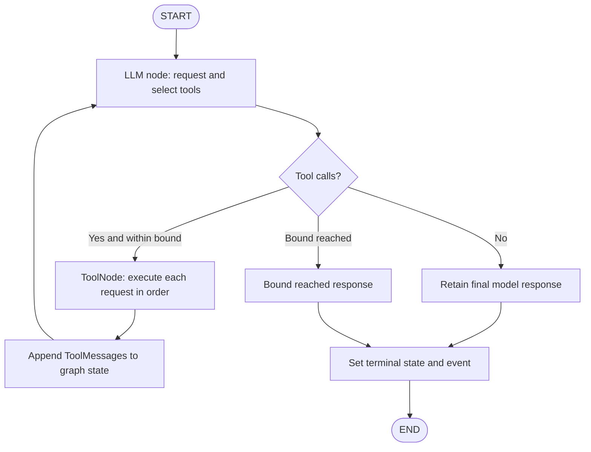

# AgentGuard Phase 1.1 Implementation Report

**Report date:** 2026-10-31
**Scope:** Targeted correction of Phase 1 architecture after the comprehensive audit. No database, API server, frontend, or ML model was added.

## 1. Abstract

This implementation corrects Phase 1's provider execution lifecycle and strengthens its telemetry contracts. Provider-backed execution now uses one execution context and stable IDs, iterates through a LangGraph LLM/ToolNode loop, feeds tool messages back to the model, returns the model's final text, and enforces a bounded tool-call limit. The deterministic offline mode remains available. Event identity, timestamp, ordering, and credential-redaction checks were added, along with explicit partial-success statuses, failure-mode validation, and no-match search behavior.

## 2. Introduction

AgentGuard is intended to observe AI agent behavior and eventually support reliability and failure analysis. The first implementation needed actual tool execution plus a trace format. The audit found that provider events and final state had different IDs and that LangGraph stopped after choosing tools. This correction addresses those findings without replacing the project structure.

## 3. Problem statement

The prior provider path selected tools in one graph node and ran them afterward through a separate runner. The model could not see returned tool messages or decide on follow-up actions, the final model response was discarded, and the replacement state created by the runner split one trace across two pairs of identifiers. Event collection also accepted inconsistent IDs and naive timestamps, and an unknown failure injection value was silently ignored.

## 4. Phase objectives

- Keep one state, execution ID, task ID, and time interval throughout each run.
- Put provider tool execution and feedback inside a real graph loop.
- Preserve the model's final natural-language content.
- Bound tool calls and report complete, partial, and failed outcomes distinctly.
- Validate and serialize events safely, including credential redaction.
- Preserve offline deterministic operation and avoid paid or networked tests.

## 5. Technical background

LangGraph models workflows with shared state, nodes, and normal or conditional edges. `ToolNode` executes tool calls from message state and returns tool messages. Pydantic validates tool inputs and event fields. The implementation follows those general patterns while keeping run metadata in a per-execution context. See the [LangGraph Graph API](https://docs.langchain.com/oss/python/langgraph/graph-api), [LangGraph `ToolNode` reference](https://reference.langchain.com/python/langgraph/prebuilt/tool_node/ToolNode), and [Pydantic validator documentation](https://pydantic.dev/docs/validation/latest/concepts/validators/).

## 6. LangGraph architecture



## 7. System design

`run_agent` selects provider or deterministic mode. `run_llm` initializes one `_RunContext`, which owns the Pydantic `ExecutionState`, `EventCollector`, start timer, failure mode, limit, and serialized tool bookkeeping. The LangGraph message state also carries the same execution and task IDs and current step. The model binds the calculator, search, and company tools. A conditional router sends calls through a `ToolNode`, then loops to the model. A response without calls reaches finalization. The default maximum is eight tool calls; callers can override it for a run.

## 8. Detailed implementation methodology

1. Reproduced the event-ID split by inspection of the old state replacement flow.
2. Replaced the one-node selector with a conditional LLM → ToolNode → LLM graph.
3. Wrapped existing functions in `StructuredTool` definitions and kept the original implementations as the shared tool logic.
4. Added one shared context to retain state and emit all events; serialized each requested tool execution to make event ordering deterministic even when a provider returns a batch.
5. Added explicit limit routing, tool validation failure capture, final-response retention, and total-run timing.
6. Added event collector invariants, metadata/error redaction, partial-success rules, validated injection modes, and search no-match results.
7. Used fake chat models with the actual LangGraph workflow for offline tests; no provider credentials or internet calls were used.

## 9. Tool-calling workflow

Each LLM request records an `llm_request` event and its elapsed time. For each returned tool call, the graph records `tool_selected`, executes it inside the LangGraph ToolNode, and appends its ToolMessage to `messages`. The next LLM call receives the full history, including tool output or an error result. The model may request another tool or return final content. Tool calls are executed one at a time in a batch to preserve deterministic state/event ordering. A request that would exceed the maximum routes to the limit response without executing the over-limit call.

## 10. Execution state management

`ExecutionState` now supports `pending`, `running`, `completed`, `partially_completed`, and `failed`. It retains one execution ID, task ID, start time, and end time. Provider and deterministic paths return this same state lifecycle; the provider path no longer creates a replacement state after model selection. The elapsed duration includes model initialization/request latency, tool execution, subsequent model requests, and final response generation.

Status semantics:

- `pending`: allocated but not started.
- `running`: started and still executing.
- `completed`: no call or execution error was recorded and a final result was produced.
- `partially_completed`: useful tool work succeeded, but another tool or execution step failed.
- `failed`: no tool succeeded or the provider/graph failed before useful work completed.

## 11. Event schema

Event types remain compatible: `execution_started`, `llm_request`, `tool_selected`, `tool_started`, `tool_completed`, `tool_failed`, `execution_completed`, and `execution_failed`. Events have unique IDs, execution/task IDs, step, UTC-aware timestamps, component/status, optional tool/duration/error fields, and metadata. The collector enforces a single identity pair, first-event start, unique event IDs, nondecreasing timestamps, one terminal event, and no appends after terminal state. Pydantic validators reject naive timestamps. Sensitive credential-like keys and string patterns in metadata/error messages are redacted; raw tool arguments and results are not copied into event metadata. This is a backward-compatible field-wise schema; `execution_status` gained `pending` and `partially_completed` values.

## 12. Module and folder descriptions

```text
agentguard/
  agent/       runtime selection and iterative LangGraph workflow
  config/      environment settings and failure-mode validation
  execution/   deterministic planner and event-backed tool runner
  schemas/     Pydantic execution state, tool calls, and events
  telemetry/   reserved package boundary for future collectors
  tools/       calculator, local mock search, company sample data
tests/unit/    offline tools, failures, event invariants, and graph tests
docs/          Phase 1 guide and this implementation report
```

## 13. Important implementation decisions

- The provider path uses a LangGraph `ToolNode` and conditional edges rather than a fixed demo plan.
- Tools call the same plain Python functions in provider and deterministic modes.
- A per-run context avoids generating new IDs midway and keeps mutable execution data out of global state.
- Sequential ToolNode invocation preserves call ordering when a model returns a batch; the graph still supports iterative decisions across LLM turns.
- Failure injection is opt-in, validated, and deterministic. No automatic retries were added.
- Search remains local and explicitly says so; zero-match queries return no unrelated records.
- Event metadata omits tool payloads and redacts common credential formats.

## 14. Testing methodology

The test suite uses pytest, Pydantic models, and fake chat models. Fake responses pass through the compiled graph and real ToolNode, so tests exercise conditional routing, message reducers, tool argument validation, tool execution, and final response selection without contacting a model provider. Demo tests execute the normal CLI-facing runner. Event tests inspect parsed JSON and collector rejection behavior.

## 15. Test case table

| Coverage area | Cases | Verification |
|---|---:|---|
| Execution IDs and state lifecycle | 1 | Unique IDs across separate executions |
| Calculator | 5 | Four operations; division by zero and invalid operation |
| Search/company | 3 | Company demo, explicit search no-match, unknown company |
| Deterministic workflow | 1 | Multiple tools and partial success |
| Failure injection/configuration | 5 | Four injected modes and invalid failure mode rejection |
| Missing LLM configuration | 1 | Clear error and deterministic demo availability |
| Event validation/serialization | 1 | JSON, unique IDs, timezone, identity and ordering checks, redaction |
| Provider LangGraph workflow | 8 | Iterative calls, batched sequential calls, returned ToolMessages, final text, max calls, duration, provider/tool errors, partial status, and consistent IDs |
| **Total collected tests** | **25** | Full pytest suite |

## 16. Actual results and observations

The actual final run was:

```text
$ PYTHONPYCACHEPREFIX=/tmp/agentguard-phase11-cache python3 -m pytest -q
.........................                                                [100%]
25 passed, 1 warning in 0.45s
```

The warning is LangGraph's pending-deprecation warning about a future default for `allowed_objects`. Python 3.9 also emits a LibreSSL/urllib3 compatibility warning. Python 3.13.12 is installed, but its environment lacks pytest and project dependencies. The suite therefore ran under Python 3.9.6 with already available packages; no dependency or interpreter installation was performed as part of this task.

Actual calculator CLI evidence:

```text
Execution ID: 529f0081-6bc4-41c2-9500-ccc9376ba898
Task: Calculate the total cost of 15 products priced at 250 each
Tools selected: ["calculator"]
Tool execution results: [{"tool_name": "calculator", "status": "completed", "result": {"operation": "multiply", "a": 15.0, "b": 250.0, "result": 3750.0}, "error": null}]
Status: completed
Final response: {'operation': 'multiply', 'a': 15.0, 'b': 250.0, 'result': 3750.0}
Duration: 1.39 ms
Events: [execution_started, tool_selected, tool_started, tool_completed, execution_completed]
```

Actual Tata Motors CLI evidence:

```text
Task: Find information about Tata Motors and summarize the available company data
Tools selected: ["company_data"]
Status: completed
Final response: {'name': 'Tata Motors', 'industry': 'Automotive', 'headquarters': 'Mumbai, India', 'summary': 'Indian automotive manufacturer producing passenger and commercial vehicles.'}
```

Actual no-match and timeout-injection observations:

```text
Search: matched=false; message="No matching results in the local mock dataset."; results=[]; status=completed
Injected timeout: tool status=failed; execution status=failed; CLI exit code=1
```

The terminal output is the evidence artifact; no screenshots were captured. Manual screenshot checklist if image evidence is needed: capture the calculator command with `--events-json`; capture the company lookup; capture a no-match search; capture timeout injection showing failed status; capture the pytest summary.

## 17. Issues encountered and solutions

- **Split IDs in provider runs:** eliminated state replacement; one context owns identifiers through terminal event. Regression test asserts all events match the returned state.
- **Graph stopped after selection:** added ToolNode routing back to the LLM and fake-model multi-turn tests.
- **LLM output discarded:** final assistant content is retained as `final_output` and printed by the CLI.
- **Tool duration omitted model latency:** total timing begins before provider initialization and ends at graph finalization.
- **Status ambiguity:** added `partially_completed` and terminal event semantics.
- **Irrelevant no-match search results:** search now requires a dataset term match and returns an explicit empty result otherwise.
- **Dependency-specific parallel option:** removed the provider-specific `parallel_tool_calls` bind argument for wider LangChain integration compatibility; each ToolNode call is instead invoked sequentially by the graph tool node.

## 18. Limitations

- A live provider call was not run; model credentials and API access were intentionally not used. Provider behavior is validated with fake chat models.
- Python 3.11+ execution was not verified because the available Python 3.13 environment lacks dependencies and installing them was out of scope. The available dependency environment is Python 3.9.6.
- The deterministic planner supports limited phrasing and is not an LLM substitute.
- Timeout injection raises a synthetic timeout; it does not interrupt a real tool operation.
- Event storage is in memory only. Redaction is not a comprehensive privacy classification system.
- The provider can select a batch; its calls are executed sequentially, and the model receives all ToolMessages after that batch. No database, retry strategy, or real web search exists.

## 19. Conclusion

The audit's critical trace-identity defect and high-priority iterative workflow gaps are addressed. The test suite confirms stable provider event identifiers, real LangGraph tool execution, iterative feedback, final answer retention, limits, failure handling, and deterministic demo behavior. The repository is ready for independent verification of the code changes; provider credentials and a Python 3.11+ dependency environment remain external verification items.

## 20. References

- LangGraph Graph API: https://docs.langchain.com/oss/python/langgraph/graph-api
- LangGraph quickstart and tool-calling graph example: https://docs.langchain.com/oss/python/langgraph/quickstart
- LangGraph ToolNode API: https://reference.langchain.com/python/langgraph/prebuilt/tool_node/ToolNode
- Pydantic validators: https://pydantic.dev/docs/validation/latest/concepts/validators/

## 21. Next verification

After dependencies are installed into the Python 3.13 environment by the repository owner:

```bash
python3.13 -m pip install -e '.[dev]'
python3.13 -m pytest -q
python3.13 -m agentguard --demo "Calculate the total cost of 15 products priced at 250 each" --events-json
python3.13 -m agentguard --demo "Find information about Tata Motors and summarize the available company data"
git diff --check
git status --short
```
