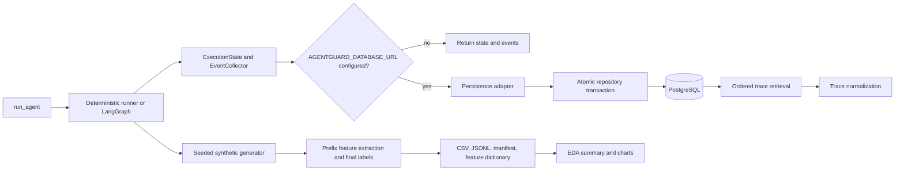
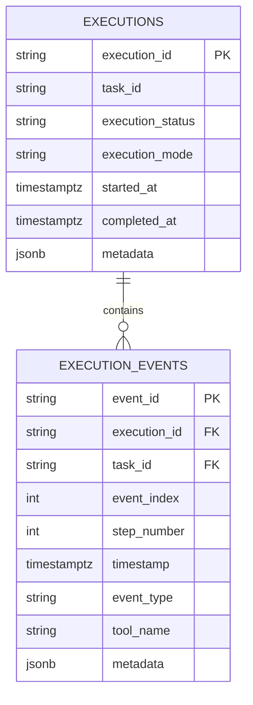

# AgentGuard Phase 2 — Implementation Report

## Abstract

Phase 2 adds optional PostgreSQL storage for completed execution telemetry, database-backed trace retrieval, trace normalization, prefix-only feature extraction, and a reproducible synthetic AgentTrace dataset. A pandas/NumPy/Matplotlib script explores the generated data. During initial implementation, live PostgreSQL verification was unavailable. A later hardening pass used a separate disposable PostgreSQL 16 instance to verify distinct bootstrap, migration, and least-privilege runtime roles; the current role/privilege correction and its latest results are recorded at the top of the verification report.

## Final hardening pass

- Compose publishes PostgreSQL on `127.0.0.1` only. Bootstrap is for local role administration, a non-superuser migration role owns the application schema objects for Alembic, and runtime uses only `CONNECT`, schema `USAGE`, `SELECT/INSERT/UPDATE` on executions and `SELECT/INSERT` on events.
- Raw trace mappings require explicit `event_id` and `timestamp`; live event construction still generates defaults. Execution state rejects naive start/end timestamps, and persisted aware timestamps normalize to UTC.
- Persistence sanitizes a copied metadata tree at insert time. Duplicate event IDs within a batch are deduplicated only when their content matches; conflicting content fails before insertion. SQL failures are logged by exception type without exception text, and SQLAlchemy hides bound parameters.
- `DatabaseSettings.url` is excluded from its dataclass representation. A new engine is still created/disposed per execution to keep this prototype's lifecycle explicit without a host application's shutdown hook. A long-running service should reuse an application-lifetime engine and pool.
- The synthetic prefix rows from the same execution share labels and are not independent observations. EDA correlations are descriptive, not inferential.

## Problem statement

Phase 1 provided structured events in process but did not persist executions or provide a controlled path from traces to prefix-level training samples. Phase 2 addresses those gaps while preserving offline execution when database configuration is absent.

## Objectives and delivered scope

- Persist execution summaries and ordered events transactionally to PostgreSQL.
- Validate, normalize, group, and retrieve traces.
- Derive inference-time features from observed event prefixes only.
- Label prefixes from final execution outcomes without adding terminal events to the features.
- Generate, export, and inspect controlled synthetic traces deterministically.
- Provide database, generation, privacy, and verification guidance.

## Technical background

The implementation uses SQLAlchemy 2.x for typed ORM models and database sessions, Alembic for schema revisions, psycopg v3 for PostgreSQL, and pandas/NumPy/Matplotlib for dataset analysis. `postgresql://` is normalized to `postgresql+psycopg://` so the selected DBAPI is explicit. The feature extraction API accepts an event prefix rather than an execution object, keeping final state and target labels outside its calculation inputs.

## Architecture

## Database schema and relationships

`executions` stores execution/task IDs, optional task text, status and mode, timestamps, duration, tool call counts, and metadata. `execution_events` stores event and parent IDs, stored order, step, timestamp, type, component, optional tool/duration/error fields, and metadata.

`execution_id` is the execution primary key; `event_id` is the event primary key. A unique `(execution_id, task_id)` parent key and a matching composite event foreign key prevent events from being associated with a different task. The foreign key cascades deletes. `event_index` is unique within an execution. Other indexes support task/time lookup and event type/tool filtering. Status is constrained to known lifecycle values. Timestamps are timezone-aware; JSON maps to PostgreSQL JSONB.

## SQLAlchemy and Alembic design

`agentguard/database/models.py` contains declarative models. `connection.py` creates an explicit engine/session factory with pool pre-ping. `repositories.py` uses one transaction for execution upsert and event insertion. The `0001_execution_telemetry` Alembic revision creates both tables and their constraints/indexes; runtime schema creation does not use `create_all`.

Execution records use PostgreSQL upsert. Event rows use insert-on-conflict with returned IDs. For skipped event inserts, the repository reads rows matching either uniqueness key and compares all event fields. Identical retries are idempotent. Reusing an event ID with changed fields or taking an existing event order with different content raises `TelemetryPersistenceError`; the enclosing transaction rolls back. Initial implementation-stage verification did not exercise this against PostgreSQL; the later isolated PostgreSQL verification did and is summarized in the current verification report.

## Telemetry integration

`run_agent` loads `DatabaseSettings`, runs the deterministic runner or LangGraph agent, and invokes `persist_if_configured` before returning. Both paths preserve execution/task identity between state and event collector. The provider graph marks mode `llm`; deterministic runs use `deterministic`. Completed, failed, and partial executions are persisted after their final state is known. If `AGENTGUARD_DATABASE_URL` (or its legacy `DATABASE_URL` fallback) is absent, no engine is constructed. A configured database error is visible to the caller, although the agent's tool work has already occurred.

Persisting after the run means this is not a streaming crash-resilient event sink. Retrieval returns one execution and event dictionaries ordered by `event_index`. Normalization is a separate processing step.

## Trace-processing methodology

`normalize_trace` requires execution and task IDs, validates every event's identity, parses serialized events, normalizes timestamps to UTC, removes identical duplicate IDs, and rejects different event content under one ID. It sorts by timestamp and reports whether input ordering changed. A trace is complete only when exactly one start event is first and exactly one terminal event is last. `group_execution_traces` groups events against a unique execution ID map and rejects orphan events.

## Feature dictionary and formulas

All are computed using only `events[:prefix_length]`. Count features return zero when no matching event is observed. Undefined continuous measurements return null in memory and blank/NaN in CSV.

| Feature | Formula/meaning | Source |
|---|---|---|
| `prefix_length` | Number of observed events | Prefix |
| `elapsed_time_ms` | Last timestamp − first timestamp; null below 2 events | Event timestamps |
| `current_step_number` | Last observed `step_number` | Event |
| `total_tool_calls_so_far` | Count of observed `tool_selected` | Event type |
| `successful_tool_calls` | Count of observed `tool_completed` | Event type |
| `failed_tool_calls` | Count of observed `tool_failed` | Event type |
| `tool_failure_rate_so_far` | failed / (failed + completed); null before outcome | Event type |
| `average_tool_duration_ms` | Mean of observed non-null completion/failure durations | `duration_ms` |
| `maximum_tool_duration_ms` | Maximum observed non-null completion/failure duration | `duration_ms` |
| `repeated_tool_call_count` | Tool selections − distinct selected tool names | `tool_selected.tool_name` |
| `distinct_tool_count` | Number of distinct selected tool names | `tool_selected.tool_name` |
| `timeout_count` | Failures matching `TimeoutError` or timeout wording | Error type/message |
| `invalid_argument_count` | Failures matching validation or invalid-argument wording | Error type/message |
| `tool_unavailable_count` | Failures matching `ConnectionError` or unavailable wording | Error type/message |
| `consecutive_failure_count` | Trailing failures in observed completed/failed outcomes | Event sequence |
| `time_since_last_failure_ms` | Last prefix timestamp − latest observed failure timestamp; null if none | Timestamp/type |
| `tool_switch_count` | Adjacent selected tool-name changes | `tool_selected.tool_name` |
| `repeated_failure_pattern_count` | Repeated observed `error_type` occurrences after first | Error type |

The redundant `unique_tools_used` alias was removed; `distinct_tool_count` is the single distinct-tool feature. `FEATURE_DICTIONARY` is exported alongside the data. `model_feature_matrix` selects only the explicit 18-feature allow-list; IDs and target fields are excluded.

## AgentTrace generation methodology

The generator uses the real deterministic `run_plan` path with a seeded random scenario/task selection, UUID5 IDs, and an injected deterministic clock. Supported scenarios are success, invalid arguments, timeout, unavailable tool, exception, repeated failure, and partial execution. Seed and scenario weights are recorded in the manifest. Dataset rows and trace JSONL are deterministic for a repeated configuration; the manifest includes a generation timestamp and therefore changes between runs.

Exports under `data/generated/agenttrace-v1/` are:

- `agenttrace_prefixes.csv`
- `agenttrace_traces.jsonl`
- `manifest.json`
- `feature_dictionary.json`

The directory is ignored by Git. Prefix rows exclude `execution_completed` and `execution_failed`; final status is used only for `eventual_failure`, `outcome_label`, and `failure_category`. Unknown outcomes stay unlabeled. Failed and partially completed outcomes are positive failure targets; completed is negative.

## Leakage prevention and split strategy

The generator explicitly passes each observed event prefix to `extract_prefix_features`; the feature function receives no execution state or final label. The terminal event is filtered before prefix construction. Tests verify that a later event does not change earlier features and that target/identifier columns do not enter `model_feature_matrix`.

Prefixes from one execution are correlated samples. Group any train/test split by `execution_id` at minimum. To test generalization to unseen task templates, hold out `task_template_id` groups as well. Do not use identifiers, `eventual_failure`, `outcome_label`, `failure_category`, or `synthetic_data` as model features.

## Dataset statistics and EDA results

Generated with `--executions 100 --seed 2026` on 2026-10-31. These are observed run outputs from controlled synthetic scenarios, not production data:

- 100 executions, 584 events, 484 prefix samples, 18 features, 27 CSV columns.
- Execution outcomes: completed 44, failed 50, partially completed 6.
- Prefix labels: failure 308, success 176; failure fraction 0.63636.
- Execution failure categories: none 44, tool exception 20, timeout 16, invalid arguments 8, unavailable 6, partial tool error 6.
- No complete duplicate rows. Missing values: elapsed time 100; failure rate 300; average duration 300; maximum duration 300; time since last failure 362. Other columns have no missing values.
- Duration in the synthetic clock: n=100, mean 114 ms, median 100 ms, min 100 ms, max 200 ms.
- Tool selections: calculator 102, company data 16, search 10. Recorded tool failures: calculator 72, company data 6.
- Pearson correlation of observed prefix failure rate with eventual failure is 0.77245. This is descriptive of constructed synthetic scenarios and is not evidence of predictive performance on real agents.

The EDA summary is `analysis/output/agenttrace-v1/eda_summary.json`. Generated PNGs in that directory are `execution_outcomes.png`, `failure_categories.png`, `tool_usage.png`, `event_frequency.png`, `execution_duration.png`, `prefix_length.png`, and `feature_failure_relationships.png`. All seven were opened and verified as PNG images; EDA counts were checked against the CSV and trace JSONL. EDA output is ignored by Git and labeled synthetic in the summary.

## Testing methodology and actual results

### Initial implementation-stage verification

At the initial implementation stage, no live PostgreSQL server was available. The earlier 47-test run and 21 Phase 2 unit-test run below are historical baseline results; they are superseded by the later isolated hardening verification, not presented as the final counts.

Environment: Python 3.13.12; SQLAlchemy 2.1.6; psycopg 3.3.6; Alembic 1.20.1; pandas 2.3.3; NumPy 2.5.4; Matplotlib 3.11.2; pytest 8.4.2; LangGraph 1.2.19; Pydantic 2.14.2; PostgreSQL 16.15.

- Initial full suite with the PostgreSQL test URL configured: `47 passed, 0 failed, 0 skipped`.
- Phase 1 regression file: `25 passed`.
- Phase 2 unit files: `21 passed`.
- PostgreSQL integration: `1 passed` against the separate `agentguard_test` database on PostgreSQL 16.15.
- Online `alembic upgrade head` applied revision `0001_execution_telemetry`; `alembic current` reported that revision as head. Catalog queries verified tables, FK, unique constraints, and indexes.
- The integration test exercised exact duplicate retry, conflicting event ID, conflicting event order, rollback, FK enforcement, ordered retrieval, and failed/partial execution persistence.

No SQLite substitution was used. The test database is disposable and the test removes its uniquely identified execution rows after completion.

### Later isolated PostgreSQL role verification

The final correction was verified on 2026-11-01 against a temporary PostgreSQL 16 instance with distinct bootstrap, non-superuser migration, and restricted runtime roles. The full suite passed `56` tests with no skips; the PostgreSQL integration test passed; Phase 1 passed `25`; and Phase 2 unit tests passed `30`. The migration role owned the AgentGuard schema objects without database ownership or SUPERUSER/CREATEDB/CREATEROLE. The runtime role's effective TEMPORARY privilege was denied after revoking it from PUBLIC and its table grants were verified. See the verification report for exact privilege results and cleanup evidence.

## Problems encountered and solutions

- Plain `postgresql://` could select a different DBAPI than declared; configuration and engine creation now normalize it to `postgresql+psycopg://`.
- Broad `ON CONFLICT DO NOTHING` previously hid altered event collisions; repository code now compares conflicting stored rows and raises on changed content/order.
- `unique_tools_used` duplicated `distinct_tool_count`; the alias was removed and the feature allow-list test guards the schema.
- EDA correlation handling now returns null for constant/undefined relationships instead of propagating non-finite correlations.
- The reported missing role came from the Mac's native PostgreSQL listener on `127.0.0.1:5432`, not the Compose container. The container itself had the expected role and database. Compose now publishes host port 5433 to avoid the collision.
- Changing a published Docker port required recreating the container. The same named data volume remained attached before and after; no data volume or database was dropped.

## Privacy and security

Task descriptions are omitted by default; opt-in storage uses regex redaction and a 2,000-character cap. Error messages are persisted and event validation redacts common API-key, token, password, and Bearer patterns. This is not comprehensive PII or secret detection. Keep `.env` untracked; use deployment-specific credential storage and configure database access, encryption, retention, and deletion policies outside this prototype.

## Limitations and future scope

- PostgreSQL integration passed for this local PostgreSQL 16 development setup; production concurrency, retention, backup/recovery, and least-privilege deployment are not verified.
- Persistence is post-execution, synchronous, and not crash-resilient during a run.
- Synthetic sample size and task diversity are small; scenario design creates label patterns.
- Regex redaction is incomplete; event free text needs a deployment data policy.
- Grouped train/test splitting and any model training/evaluation are future work.
- Production retries, connection pooling policy, retention/deletion, and observability need deployment-specific design.

## References

- [SQLAlchemy PostgreSQL dialect and psycopg URLs](https://docs.sqlalchemy.org/en/20/dialects/postgresql.html)
- [SQLAlchemy engine URLs](https://docs.sqlalchemy.org/en/20/core/engines.html)
- [Alembic tutorial](https://alembic.sqlalchemy.org/en/latest/tutorial.html)
- [Psycopg 3 documentation](https://www.psycopg.org/psycopg3/docs/)
- [pandas user guide](https://pandas.pydata.org/docs/user_guide/index.html)
- [NumPy reference](https://numpy.org/doc/stable/)
- [Matplotlib user guide](https://matplotlib.org/stable/users/index.html)
- [LangGraph documentation](https://langchain-ai.github.io/langgraph/)
- Kaufman, Rosset, Perlich, and Stitelman, “Leakage in Data Mining: Formulation, Detection, and Avoidance,” *ACM Transactions on Knowledge Discovery from Data*, 6(4), 2012. [doi:10.1145/2382577.2382579](https://doi.org/10.1145/2382577.2382579)
